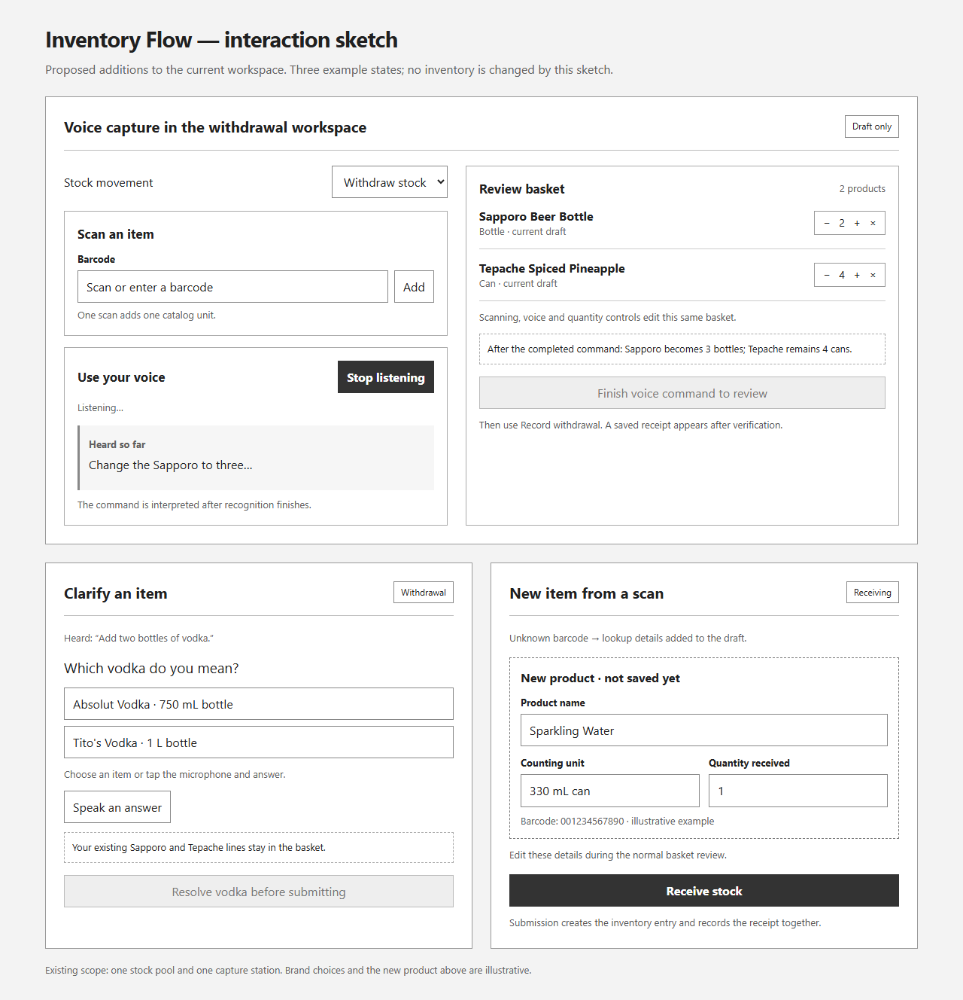

# Design: New-item receiving and browser voice for the McCormick prototype

Generated by /office-hours on October 25, 2026 (America/Chicago)

Branch: master | Repo: jokohn/inv-log | Baseline: c0a633b

Status: APPROVED | Mode: Builder

## Problem Statement

Prepare inv_flow for the October 26 Hyatt Regency McCormick visit: demonstrate a working capture prototype, let managers and staff try it, and learn what would make it usable. This is a feedback exercise, not a department handoff or a production-readiness claim.

The requested additions are new-item receiving from scanned barcodes and voice commands that create and edit a pending receiving or withdrawal basket.

## What Makes This Useful

Scanning, speech and quantity controls feed one visible basket. A person can speak a list, correct one line, resolve an ambiguous product, then submit the reviewed order. An unfamiliar barcode can populate a new receiving line without editing Sheets separately.

## Decisions Already Made

- Browser transcription is selected for this demo (D6 A). The user reports enough prior testing to use it tomorrow; a separate recorded-audio transcription service is unnecessary for the selected direction.
- Successful barcode lookup results go directly into editable draft fields, with the ordinary final basket review (D4 B). There is no separate new-item confirmation gate.
- The rough layout is accepted (D7 A): voice beside scanning, one shared basket, a focused item-clarification area, and editable new receiving lines.
- The optional office-hours second opinion was skipped (D5 B). The requested engineering review still follows.

## Constraints and Existing Behavior

- Retain the current local laptop/browser architecture, one stock pool and one writer. New deployment targets have not been selected.
- inv_flow uses the v1 tabs, stable product IDs, whole-number catalog units, formula-derived balances, a durable request journal, verification and recovery locks.
- The separate voice experiments used legacy tabs with entered counts, missing UPCs and some fractional bulk operations. Their behavior and historical balances must not be treated as current inv_flow behavior or synchronized automatically.
- Preserve repeated scan-to-increment, plus/minus controls, direct quantity entry, empty-basket-only direction changes and whole-basket rejection of insufficient withdrawals.
- Human submission remains the write gate. A scanner beep, transcript or model response is not a saved receipt.

## Selected Approach

### New-item receiving

Check the scanned barcode against the current catalog first. In receiving mode, an unknown barcode can trigger an external product lookup. Successful results prefill an editable new-product line in the draft. The scan still represents one catalog unit, with quantity editable through the basket. Repeated scans should consolidate the pending item.

On submission, the proposed persistence mechanism is one batch containing the new inventory rows and receipt transactions, followed by readback of both. It must extend the existing journal/recovery path so a retry cannot duplicate the item or its receipt. The engineering review must settle the exact representation and failure handling before implementation.

### Voice commands

The operator selects the movement direction, activates the microphone, speaks and finishes the command. Browser recognition supplies text. Partial recognition text can be displayed, but only a completed command is interpreted into draft changes.

The backend supplies the transcript, current basket, movement context and relevant catalog entries to a language model. The model proposes add, increment, replace-quantity, remove, cancel-draft or clarification actions. Application code validates those proposals; the model does not write arbitrary spreadsheet cells.

Follow-up commands use the same draft context. “Add three more” increments; “change to three” replaces. Clarification retains the other lines. Product choice depends on the intended catalog match; stock availability alone does not establish the speaker's intended brand.

```text
Known scan ---------------------------+
Unknown receiving scan -> lookup -----+-> visible draft basket
Browser microphone -> text -> model --+       |
                              |               | human submit
                              +-> clarify ----+
                                              v
                                   existing guarded save
                                              |
                                   rows + balances verified
                                              |
                                         saved receipt
```

Proposed engineering checks include stale voice responses after a draft edit, duplicate recognition delivery, capture-method attribution, catalog changes during onboarding and recovery after an uncertain new-item save. These are subjects for the engineering review, not claims of implemented safeguards.

### Interaction sketch



The sketch's generated source is `artifacts/planning-context/gstack-sketch-ablyvlto/sketch.html`. Names, brands and the new product are illustrative; the sketch does not establish actual catalog contents.

## Alternatives Considered

- Browser transcription: selected based on the user's existing recognition tests and the demo deadline.
- Completed audio clips sent to a transcription service: not selected; the user considers browser transcription adequate for this visit.
- A continuous live voice session: not selected during the A/B comparison; this design uses discrete microphone turns.

## Open Questions for Engineering Review

These remain unresolved. Approving this document does not silently choose their answers.

1. **Lookup provider and incomplete results:** select the provider, and decide the behavior for no match, network failure, conflicting results or absent counting units. D4 B still rules out a separate confirmation gate for complete successful results.
2. **Voice provider and context:** select the model/service and verify API access; settle how much catalog data to supply and whether bounded read-only lookup functions are needed.
3. **Product scope:** decide whether tomorrow needs manual selection/creation for goods without barcodes, case conversion or fractional quantities. Field discovery is already part of the visit; these broader behaviors are not approved additions merely because the knowledge base describes them.
4. **Movement context:** settle whether operator and destination fields belong in this build. The legacy tests captured them; the current app does not provide that workflow.
5. **Voice failures and draft consistency:** settle how late responses, interrupted recognition, contradictory directions and unanswered clarification are represented and recovered while preserving human approval of the current draft.
6. **Persistence compatibility:** settle new-product request identity, exact rows/formulas and verification evidence, capture-method representation and compatibility with existing saved requests/history.

## Success Criteria and Evidence

- A supported unknown barcode in receiving produces an editable pending product; no inventory is created until submission.
- A completed voice command can add two existing products; a follow-up changes one quantity or removes one line without disturbing the other.
- An ambiguous product produces a targeted clarification and retains the pending work.
- A final submission uses verified persistence; repeat submission and an interrupted save do not create duplicate movements or false success messages.
- Existing barcode withdrawal/receiving behavior continues to work.

The unchanged baseline passed 83 offline tests with one dependency deprecation warning. These tests use simulated spreadsheet services. They establish neither the new features nor live Sheets, microphone, scanner or MacBook acceptance. The user reports browser transcription testing separately.

## Distribution and Dependencies

Use the existing local application and launcher on the demo laptop. A new hosted service, tablet network exposure, public release or MCP server is not required by the selected direction. Rehearse the integrated workflow on the actual device and approved test spreadsheet before claiming readiness.

Dependencies are a usable barcode data source, model API access, the existing Sheets connection, and connectivity for the services used. A local demo workbook remains an existing capture fallback; it does not make cloud interpretation or lookup work offline.

## Next Steps

Finish the engineering review of the open decisions and current interfaces. Then implement the agreed new-item receiving and voice draft-editing changes, extend relevant tests, and rehearse the complete flows. This document is a design discussion, not authorization to mutate a spreadsheet or start feature development before that review.

## The Assignment

At the visit, observe representative deposits and withdrawals. Record how many items lack barcodes; case/loose-unit and partial-container handling; items per request; noise, lighting, power and Wi-Fi; and where participants hesitate or correct the prototype. Use observed examples to choose the next enhancement rather than assuming a complete unit or deployment model now.

## What I Noticed About Your Reasoning

- You asked for a “prototype that's good enough that it can be used to generate feedback,” which gives the demo a concrete learning purpose.
- You said browser transcription has been tested enough for tomorrow. That evidence changed the selected approach from the reviewer's recorded-audio recommendation to browser transcription.

## Research Receipts

- [Barcode Lookup API](https://www.barcodelookup.com/api) and [UPCitemdb API](https://www.upcitemdb.com/api): available integration options; representative hotel-item coverage remains untested.
- [Open Food Facts API](https://openfoodfacts.github.io/documentation/docs/Product-Opener/api/): contributed food data with accuracy and licensing conditions.
- [Browser speech recognition](https://developer.mozilla.org/en-US/docs/Web/API/SpeechRecognition): browser-dependent recognition behavior.
- [Function calling](https://developers.openai.com/api/docs/guides/function-calling): constrained application functions can provide catalog context and proposed actions.
- [Sheets batchUpdate](https://developers.google.com/workspace/sheets/api/reference/rest/v4/spreadsheets/batchUpdate): updates within one valid request apply together; readback and the single-writer boundary remain necessary.

<!-- gstack:office-hours:concerns:start -->
## Reviewer Concerns

Disposition: COMPLETED

Stop: PASS

No unresolved findings.
<!-- gstack:office-hours:concerns:end -->
